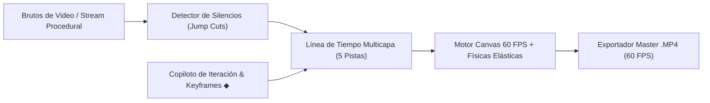

# 🎬 01 — Motor de Edición Automático (Estudio NLE Interactivo 60 FPS)

> **Desarrollador Líder:** Rogerr Carvajal ([@rogerrcarvajal](https://github.com/rogerrcarvajal))  
> **Especialidad:** Arquitectura de Software con Modelos y Agentes Inteligentes  
> **Metodología:** Desarrollo Autónomo en Bucle (Looping) y Trazabilidad de Sprints  

---

## 1. Resumen Técnico

El **Motor de Edición Automático (Gemini 4 Argon Motion Engine — Estudio NLE Interactivo 60 FPS)** es una estación de edición no lineal (NLE) web y local diseñada para automatizar el flujo de posproducción de creadores de contenido:

- **Jump Cuts Automáticos**: Detección de silencios (`>0.48s`) con representación visual en pista de onda de audio (`A1 • Onda & Cortes`).
- **Subtítulos Dinámicos Elásticos**: Renderizado con físicas de resorte (`curvas elásticas`) e iluminación de palabra activa en tiempo real.
- **Control de Fotogramas Clave (`◆ Keyframes`)**: Interpolación de Escala/Zoom, Posición X/Y y Opacidad directamente desde el monitor interactivo (arrastrar y rueda del ratón) o el inspector.
- **Motion Graphics Multicapa estilo Apple Keynote**: 6 plantillas a 60 FPS (`Bento 3D • Nodos After Effects Pro`, `Curvas Bézier 3D`, `Checklist Viral`, `Apple Liquid Glass`, `Contador Neón`, `Kinetic Typography`).
- **Copiloto de Iteración en Lenguaje Natural**: Modifica estilos y agrega escenas mediante órdenes directas.
- **Exportación Real a `.MP4` (60 FPS)**: Captura de flujo `CanvasCaptureMediaStreamTrack` a 60 fotogramas por segundo.

---

## 2. Arquitectura del Módulo

---

## 3. Archivos del Módulo

- [`index.html`](./index.html): Interfaz completa del Estudio NLE Interactivo a 60 FPS.
- [`dashboard_argon.html`](./dashboard_argon.html): Alias de acceso rápido compatible con la guía de Viegas Academy.
- [`motor_edicion_local.py`](./motor_edicion_local.py): Motor en Python 3.11+ con modelos **Pydantic v2** y soporte `FFmpeg` (`silencedetect`) para procesamiento local.
