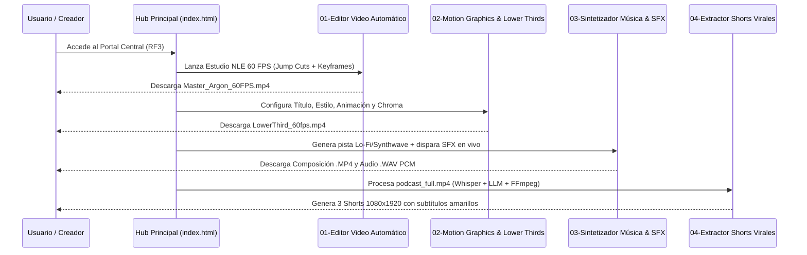

# 📄 Ficha Técnica: ContentCreator-Tools (Suite Gemini 4 Argon & Google Antigravity)

> **Desarrollador Líder:** Rogerr Carvajal ([@rogerrcarvajal](https://github.com/rogerrcarvajal))  
> **Especialidad:** Arquitectura de Software con Modelos y Agentes Inteligentes  
> **Versión:** 1.0.0  
> **Estado:** Producción  
> **Tecnologías:** HTML5 Canvas (60 FPS), Web Audio API, CSS3 Quantum Glassmorphism, Python 3.11+, Pydantic v2, Whisper, FFmpeg  

---

## 1. Resumen Técnico

El proyecto **ContentCreator-Tools** materializa las cuatro herramientas de producción audiovisual demostradas con **Gemini 4 Argon** y **Google Antigravity**, organizadas en directorios independientes listos para despliegue web local (XAMPP) y sincronización con GitHub (`contect-creator-tools`).

---

## 2. Diagrama de Flujo y Componentes (Mermaid)

---

## 3. Especificación de Contratos y Módulos (RF1, RF2, RF3)

| ID Requerimiento | Módulo / Ruta | Entradas | Salidas |
| :--- | :--- | :--- | :--- |
| **RF1.1 / RF2** | `01-editor-video-automatico/` | Videos brutos, formato (`9:16`, `16:9`, `1:1`), estilo (`Apple`, `Hormozi`, `Kinetic`), keyframes `◆` | Video `.MP4` a 60 FPS + Manifiesto JSON validado con Pydantic v2 |
| **RF1.2 / RF2** | `02-motion-graphics-lower-thirds/` | Título, Subtítulo, Badge, Estilo (`Minimalista`, `Neón`, `Corporativo`, `3D`), Animación, Fondo Chroma | Video `.MP4` Full HD (`1920x1080` @ 60 FPS) |
| **RF1.3 / RF2** | `03-sintetizador-musica-sfx/` | Género (`Lo-Fi`, `Synthwave`, `Cyberpunk`, `Ambient`), BPM, Filtro, 8 Pads SFX | Video reactivo `.MP4` + Archivo `.WAV` PCM 44.1kHz |
| **RF1.4 / RF2** | `04-extractor-shorts-virales/` | Video largo (`podcast_full.mp4`), modelo Whisper, duración objetivo (`40s`) | 3 Videos `1080x1920` `.MP4` + 3 Archivos `.ASS` con palabra actual en amarillo + Reporte JSON |
| **RF3** | `index.html` | Selección de categoría o búsqueda por texto | Redirección inmediata a cada herramienta y visor de prompts maestros |

---

## 4. Cumplimiento de Reglas Globales y Locales

1. **`00-global-principles.md`**: Código limpio, modular, tipado estricto en Python 3.11+ y cero secretos en código fuente (`.env.example` incluido).
2. **`20-python-ai-services.md`**: Modelos `pydantic.BaseModel` v2 con validadores de campo y funciones asíncronas (`async def`).
3. **`40-frontend-uiux.md` & `brand-identity`**: Modo oscuro cuántico (`#0b0f19`), tarjetas `.card-glass`, estados de interfaz completos, semántica HTML5 y atributos `id` únicos en todos los controles interactivos.
