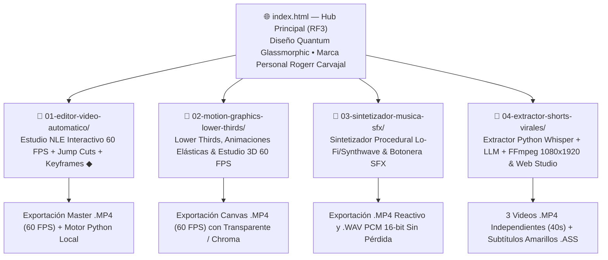

# 🚀 ContentCreator-Tools — Suite de Producción Audiovisual con IA (Gemini 4 Argon & Google Antigravity)

> **Desarrollador Líder:** Rogerr Carvajal ([@rogerrcarvajal](https://github.com/rogerrcarvajal))  
> **Especialidad:** Arquitectura de Software con Modelos y Agentes Inteligentes  
> **Metodología:** Desarrollo Autónomo en Bucle (Looping) y Trazabilidad de Sprints  

[](https://github.com/rogerrcarvajal)
[](https://github.com/rogerrcarvajal)
[](https://antigravity.google)

---

## 📌 1. Resumen Ejecutivo

**ContentCreator-Tools** es un ecosistema completo de herramientas para creadores de contenido e ingenieros multimedia, desarrollado con **Google Antigravity** y **Gemini 4 Argon** tomando como referencia el flujo de trabajo y los prompts maestros de producción audiovisual:

- **Canal de Referencia**: [Google Gemini 4 Argon: Casos de uso para creadores de contenido](https://www.youtube.com/watch?v=cO-U7PczHQI)
- **Prompts Maestros de Referencia**: [Viegas Academy Classroom — Recursos Editores de Video](https://www.skool.com/viegas-academy-free-2786/classroom/75e48184?md=5700208bc48944aebb7cc56bf88e9a55)

---

## 🏗️ 2. Arquitectura del Ecosistema (Mermaid)



---

## 📂 3. Estructura Modular por Carpetas (RF1, RF2, RF3)

| Carpeta / Archivo | Herramienta Desarrollada | Tecnologías Clave |
| :--- | :--- | :--- |
| [`index.html`](./index.html) | **Website Principal / Hub de Herramientas (RF3)** con buscador, filtros por categoría, visor de prompts y enlaces directos. | HTML5 Semántico, CSS3 Glassmorphism, Vanilla JS |
| [`01-editor-video-automatico/`](./01-editor-video-automatico/) | **Motor de Edición Automático — Estudio NLE Interactivo 60 FPS** (Jump Cuts automáticos, subtítulos elásticos, 6 plantillas Apple Bento 3D, editor de Keyframes `◆` y línea de tiempo de 5 pistas). | Canvas 2D 60 FPS, MediaRecorder, Python 3.11+, Pydantic v2 |
| [`02-motion-graphics-lower-thirds/`](./02-motion-graphics-lower-thirds/) | **Creador de Lower Thirds, Animaciones & Estudio 3D** (Estilos Minimalista, Neón, Corporativo y 3D Orb; animaciones Suave, Rebote, Entrada Rápida y Giro 3D; fondos Transparente, Oscuro y Chroma). | Canvas 1080p 60 FPS, WebCodecs / MediaRecorder |
| [`03-sintetizador-musica-sfx/`](./03-sintetizador-musica-sfx/) | **Sintetizador de Música Procedural & Efectos de Sonido (SFX)** (Secuenciador Lo-Fi/Synthwave libre de copyright, botonera SFX en vivo, visualizador FFT y exportación MP4/WAV). | Web Audio API, AnalyserNode, OfflineAudioContext WAV |
| [`04-extractor-shorts-virales/`](./04-extractor-shorts-virales/) | **Extractor Automático de Shorts Virales** (Transcripción con Whisper timestamps, selección LLM de los 3 fragmentos de 40s, crop central `1080x1920` con FFmpeg y subtítulos con palabra actual en amarillo). | Python 3.11+, Pydantic v2, Whisper, FFmpeg, Web Studio 9:16 |

---

## 🧪 4. Ejecución y Verificación de Pruebas

1. **Modo Web (XAMPP / Navegador Directo)**:
   - Abrir `http://localhost/ContentCreator-Tools/index.html` o abrir directamente [`index.html`](./index.html) en cualquier navegador moderno.
2. **Modo Consola Python (Extractor de Shorts & Motor NLE Local)**:
   ```bash
   python 04-extractor-shorts-virales/extractor_shorts.py --input podcast_full.mp4 --output-dir output_shorts
   python -m pytest tests/test_suite.py
   ```
